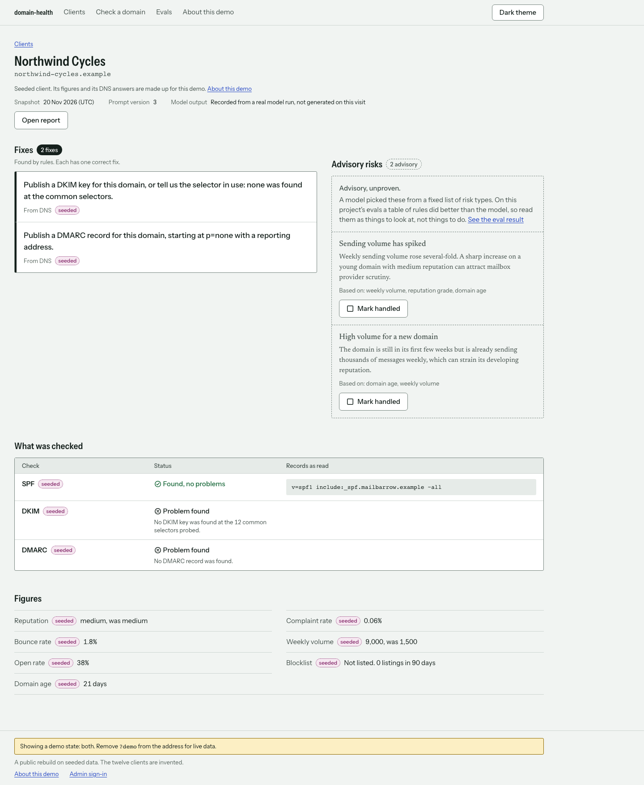
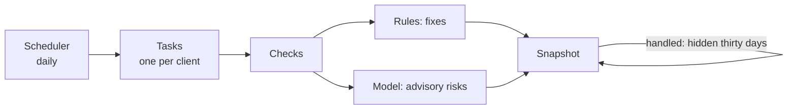

# domain-health

A daily health check for the email-sending domains of many clients.

I built the eval before the prompt. It showed that a plain table of rules beats the model at choosing which risks to raise, so the product ships the rules for the action list and shows the model's picks beside it, marked advisory. Knowing when not to use a model was the result.

**Live demo:** <https://domain-health-rose.vercel.app>, a rebuild on synthetic data.



## The point

Working out why a client's email lands in spam is specialist work. It means checking authentication records, reputation reports, blocklists and sending statistics that live in five or six different places. One specialist did it by hand, so it happened when she had time, or after a client had already been hurt, and it could not cover every client.

The check gives each client two lists a day. A **fix** is a fault with one correct action, such as a missing SPF record, and rules read it straight off the data. A **risk** is a judgment call about something that works today, such as a DMARC policy left at `none` on a busy domain, which a specialist may or may not raise. Risks looked like work for a model.

The eval tested that on 48 cases, labelled with the risks a specialist would flag and the ones that would be wrong to raise. The same code scored the model and a plain table of rules: the labelling rubric's thresholds written as code. In 30 cases the label is exactly what those thresholds give, so the table is right by construction. The other 18 are judgment calls that depart from them, where a model could earn its place. There, in each run, the model found one more expected risk than the table and raised three the label calls wrong, where the table raised none. A wrong risk tells a client to worry about something that is fine, so the bar for those is zero, and only the table met it.

## How it works



1. Cloud Scheduler runs once a day and queues one Cloud Task per client.
2. Each task checks the client's SPF, DKIM and DMARC records, the DNS records that say who may send mail for a domain, and reads the reputation and sending figures.
3. Rules turn those into the fix list.
4. A model picks up to eight risks from a closed list of thirteen types. Code validates its output (a known type, no duplicates, no number that is not in the input) and shows the first five.
5. The day's result, the snapshot, goes to Firestore. A person marks a risk handled, and it stays hidden for thirty days.

| Real | Seeded |
|---|---|
| The DNS checks (SPF, DKIM, DMARC) on any domain a visitor types: real lookups, TXT records only. | The twelve clients. They are invented companies on `.example` domains. |
| The schedule, the task queue and the daily writes to Firestore. | Their reputation and sending figures, which would come from accounts the demo does not have. |
| The deployed services: the backend on Cloud Run, the frontend on Vercel. | Their DNS answers, from zone files in the repository. |
| The eval runs: five paid runs of a live model, 144 calls each, with every answer committed. | Their model output on the hosted demo: recorded from real model runs (`risks-v3` on `gpt-6.1-terra`, 2026-11-20) and replayed. |

More: [ARCHITECTURE.md](docs/ARCHITECTURE.md), [decisions/](docs/decisions/).

## Results

Each case was run three times: 144 case-runs. The four bars:

- **Coverage:** the share of expected risks found in the first five returned.
- **Precision:** the share of the first five that the label calls expected or acceptable.
- **Harmful:** the count of returned risks the label calls wrong.
- **Stability:** the share of cases whose first five are the same in all three runs.

<!-- eval-table:start -->
Prompt in use: `risks-v3` (sha256 `11e24baa36aa`). Model: `gpt-6.1-terra`, reasoning effort `none`, temperature 0. Run recorded 2026-11-19: 3 runs of 48 cases, 144 case-runs. Outputs dropped by validation: 0 of 144.

| | coverage (bar: at least 0.80) | precision (bar: at least 0.80) | harmful (bar: exactly 0) | stability (bar: at least 0.90) | All four bars met |
|---|---|---|---|---|---|
| Model, prompt in use: `risks-v3` | 0.896, met | 0.962, met | **9 in 144 case-runs, missed** | 0.979 (47 of 48 cases), met | **no: harmful missed** |
| Rules-only baseline: the rubric's bands as code, no model | 0.881, met | 1.000, met | 0 in 144 case-runs (48 cases, 3 runs whose first five agreed on 48), met | 1.000 (48 of 48 cases), met | yes |
| Model, not in use: `risks-v4`, same model | 0.881, met | 0.940, met | **12 in 144 case-runs, missed** | **0.812 (39 of 48 cases), missed** | **no: harmful and stability missed** |
<!-- eval-table:end -->

The prompt in use returned 9 in 144 case-runs that were harmful, the same three wrong risks each run, and ships as a named miss. The labels were not written or reviewed by a deliverability specialist. Detail: [docs/EVALS.md](docs/EVALS.md).

## Run it

Needs `uv`, `pnpm`, Node 24 and JDK 21 (for the Firestore emulator). No key.

```bash
make setup          # install both toolchains
make dev            # backend on the Firestore emulator, frontend on :3000
make check          # format, lint, types, tests
make eval           # free: scores the committed recordings
make browser-test   # one visitor journey in Chromium, on the emulator
```

## Production notes

- **Retries:** a task is tried at most five times, with ten seconds to five minutes between tries.
- **Idempotent writes:** a snapshot's document ID is its date, so a rerun overwrites.
- **Spend:** Cloud Run is capped at one instance. Production holds no model key and makes no model call.
- **Live-check limits:** for the typed-domain check, five checks per address per ten minutes, 200 a day, and forty DNS queries per check.
- **Auth:** the daily job's routes accept only a Google-signed OIDC token. The public API accepts only the frontend's server, which holds a shared secret.
- **Sandbox:** a visitor's "handled" clicks go to their own sandbox, named by a signed cookie, so nobody else sees them.
- **Fallback:** if the backend is down, the frontend serves bundled snapshots with a notice.

The scheduler, queue, auth and sandbox are deliberately production-shaped for a seeded demo.

## How it was built

Built with AI assistance (Claude Code) under checks I set: a plan reviewed before any code, tests first on the core logic, `make check` and CI with a secret scan on every pull request, and an independent review of each phase's diff. The full build record is kept at the [`build-log` tag](https://github.com/nkanyi-so/domain-health/tree/build-log).

## Next

- Labels from a deliverability specialist, on real domains.
- Inputs a table cannot key on, such as free text or history.
- More cases, not more runs.
